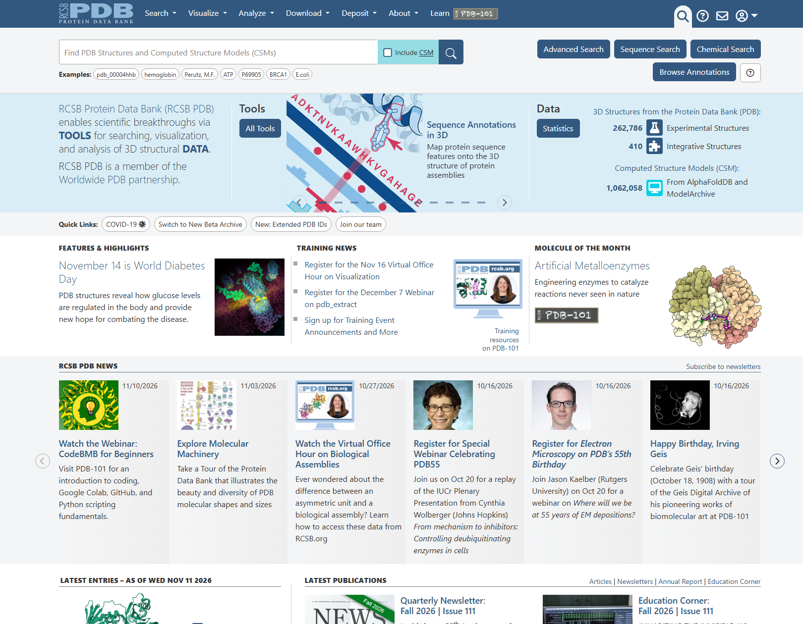

# 🧬 PDB – Protein Data Bank

🔗 **Website:** [https://www.rcsb.org/](https://www.rcsb.org/)

## 📌 What is it used for?

The **Protein Data Bank (PDB)** is a global repository dedicated primarily to the three-dimensional (3D) structures of proteins, alongside other biological macromolecules like nucleic acids. It enables researchers to understand protein function by linking 3D shape and atomic interactions directly to cellular mechanisms.

## 🗂️ Type of database

| By data origin | By data review               |
| -------------- | ---------------------------- |
| Primary        | Reviewed / Validated (wwPDB) |

PDB is a **primary database** because it stores 3D structural data obtained directly from experimental methods (such as X-ray crystallography, NMR, or Cryo-EM).
 
PDB entries undergo a **rigorous curation and validation process** by the wwPDB, ensuring high geometric and experimental quality control before publication.

## ⭐ Key features

- Stores **three-dimensional structures** of proteins, nucleic acids, and complex biological macromolecules.
- Contains structures determined using experimental techniques such as **X-ray crystallography**, **Nuclear Magnetic Resonance (NMR)**, and **Cryo-Electron Microscopy (Cryo-EM)**.
- Represents the spatial position of atoms using **X, Y, and Z coordinates**.
- Includes **wwPDB validation reports** and quality metrics to evaluate structural reliability.
- Provides interactive tools to **visualize and explore** 3D molecular structures.
- Allows users to **download structural data** in standard formats (e.g., PDB, mmCIF) for further computational analysis.
